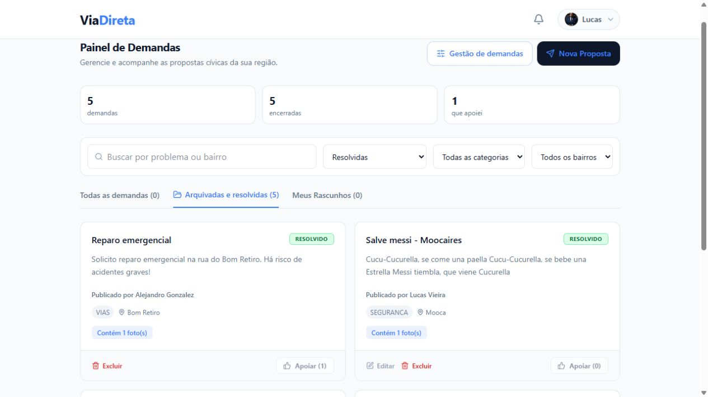
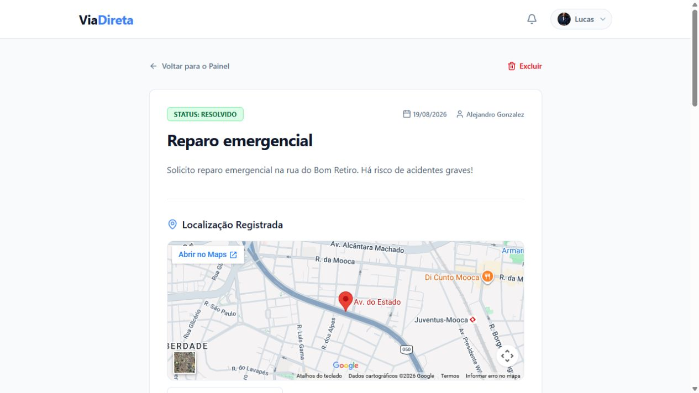
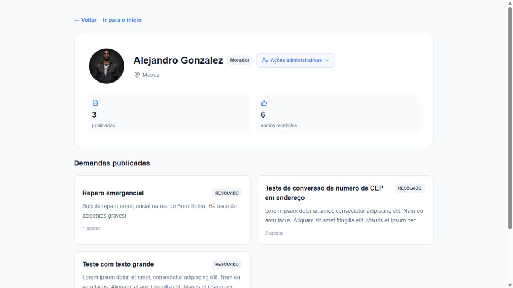
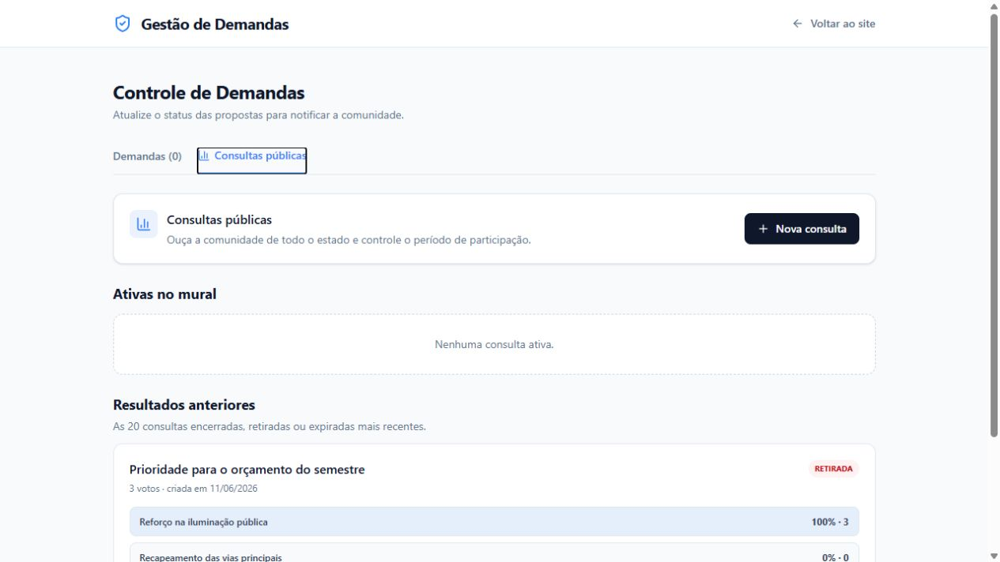
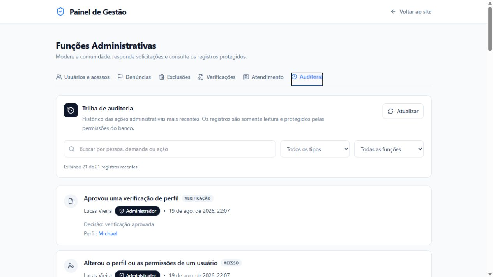

  

# ViaDireta

O **ViaDireta** é uma plataforma de interação cívica desenvolvida para aproximar cidadãos e gestores estaduais. A experiência reúne publicação, apoio, debate, consultas públicas, acompanhamento transparente e retorno oficial em um único fluxo.

O projeto é idealizado, arquitetado e gerido por **Lucas Vieira**.

> Projeto funcional em ambiente de demonstração. A aplicação não está aberta ao público e o código-fonte é privado.

## O problema

Demandas da população costumam ficar espalhadas entre redes sociais, mensagens privadas e canais sem acompanhamento claro. Isso dificulta a priorização, a identificação de responsáveis e a transparência sobre o que está sendo feito.

## A solução

O ViaDireta organiza cada demanda em uma jornada verificável:

1. O cidadão registra o problema com descrição, localização e evidências.
2. A comunidade apoia, acompanha e participa da discussão.
3. Um gestor ou agente público assume formalmente a responsabilidade.
4. Atualizações oficiais mostram publicamente o andamento do atendimento.
5. A conclusão ou rejeição exige justificativa e permanece preservada no histórico.

## O produto em funcionamento

As imagens abaixo foram registradas no ambiente local de demonstração com dados de teste. Informações privadas, como e-mails, mensagens de atendimento, denúncias e documentos de verificação, não são exibidas.

### Mural de demandas

Visão geral com indicadores, filtros territoriais e separação entre demandas ativas, arquivadas e resolvidas.

### Detalhe e acompanhamento

Página individual com autoria, localização, evidências, apoios, comentários, responsável e linha do tempo pública.

### Perfil público

Identidade comunitária, verificações, histórico de participação e demandas publicadas reunidos em uma página pública.

### Gestão e consultas públicas

Área operacional em que gestores e agentes públicos conduzem demandas e administram consultas com período de participação e resultados preservados.

### Administração e moderação

Ambiente protegido para gestão de usuários, permissões, verificações, denúncias, sanções, atendimento e auditoria.

## Experiências principais

### Cidadãos

- Cadastro, perfil público e preferências pessoais.
- Demandas com endereço, GPS, mapa, fotos e categorias.
- Apoios, acompanhamento, comentários e notificações.
- Rascunho automático durante a criação de uma demanda.
- Linha do tempo pública com o responsável e as atualizações oficiais.
- Exclusão de conta autogerenciada com período de recuperação.

### Gestão pública

- Fila operacional com filtros por situação da demanda.
- Responsável identificado para cada atendimento.
- Atualizações públicas assinadas por quem as publicou.
- Encerramento com justificativa e histórico preservado.
- Criação e administração de consultas públicas com prazo definido.
- Histórico das consultas encerradas ou retiradas do mural.

### Administração e moderação

- Análise de denúncias e solicitações de verificação.
- Gestão de funções e acessos institucionais.
- Restrição temporária e banimento com justificativa.
- Canal privado de atendimento à comunidade.
- Administração master única e protegida.
- Trilha de auditoria para ações administrativas.

## Governança e confiança

O produto diferencia as responsabilidades exibidas publicamente:

- **Cidadão:** publica, apoia, acompanha e debate demandas.
- **Gestor:** conduz o atendimento e publica atualizações oficiais.
- **Agente público verificado:** possui identidade institucional verificada e acesso à gestão de demandas.
- **Moderador:** atua sobre denúncias, verificações e integridade da comunidade.
- **Administrador:** gerencia usuários, permissões e operações administrativas.
- **Administrador master:** titular único da governança máxima da plataforma.

## Recursos de transparência

- Histórico público das mudanças de status.
- Identificação do responsável pela demanda.
- Assinatura de autoria nas atualizações oficiais.
- Justificativa obrigatória para decisões finais.
- Demandas encerradas preservadas para consulta.
- Comentários encerrados automaticamente ao final da gestão.
- Registros administrativos protegidos e auditáveis.

## Princípios do produto

- **Transparência:** a população acompanha quem assumiu a demanda e o que está sendo feito.
- **Responsabilidade:** decisões administrativas exigem justificativa e deixam registro.
- **Privacidade:** documentos comprobatórios ficam privados e possuem descarte programado.
- **Clareza:** cada função recebe apenas os recursos necessários para sua atuação.
- **Acessibilidade territorial:** filtros e localização ajudam a organizar demandas em escala estadual.
- **Mobile first:** a interface foi pensada para o uso cotidiano em celulares.

## Tecnologias

- Next.js e React
- TypeScript
- Supabase Auth, PostgreSQL e Storage
- Tailwind CSS
- Vitest e Playwright
- GitHub Actions

## Estado do projeto

O MVP está funcional e preparado para apresentações controladas, demonstrações locais e avaliação comercial. Os principais fluxos de cidadãos, gestores, agentes públicos, moderadores e administradores estão implementados.

Uma abertura pública será tratada como uma etapa própria de lançamento, incluindo hospedagem definitiva, configuração de e-mails, testes de carga, observabilidade, backups, revisão jurídica e validações adicionais de segurança.

Uma demonstração privada pode ser apresentada sob solicitação.

_Última atualização desta vitrine: agosto de 2026._

## Direitos

O ViaDireta e seus materiais são disponibilizados apenas para apresentação e avaliação. O código-fonte não faz parte deste repositório. Todos os direitos reservados.
