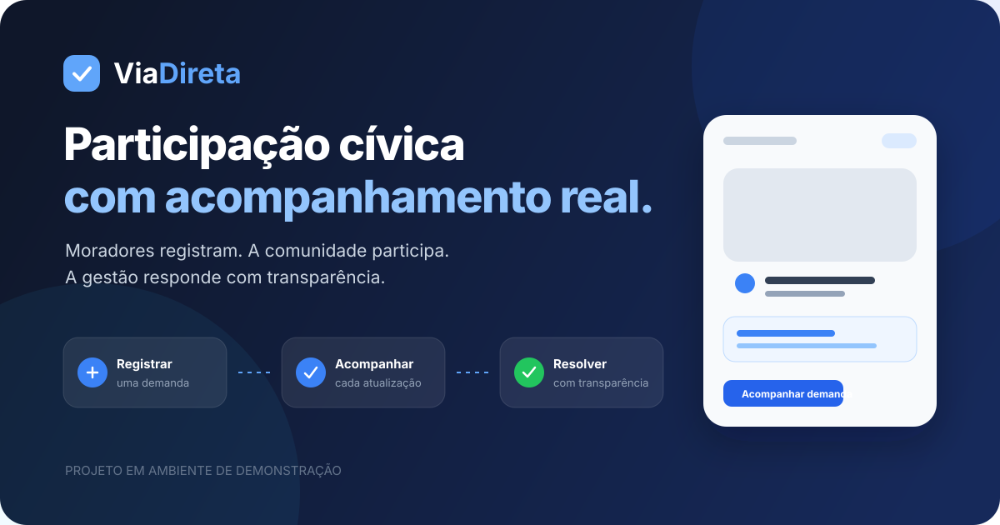

  

# ViaDireta

O **ViaDireta** é uma plataforma de participação cívica criada para aproximar moradores e responsáveis pela gestão de demandas locais. A experiência reúne publicação, apoio, acompanhamento transparente e retorno oficial em um único fluxo.

> Projeto funcional em ambiente de demonstração. A aplicação não está aberta ao público e o código-fonte é privado.

## O problema

Demandas de bairro costumam ficar espalhadas entre redes sociais, mensagens privadas e canais sem acompanhamento claro. Isso dificulta priorização, transparência e confiança entre a comunidade e quem pode resolver o problema.

## A solução

O ViaDireta organiza cada demanda em uma jornada verificável:

1. O morador registra o problema com descrição, localização e evidências.
2. A comunidade apoia, acompanha e participa da discussão.
3. Um gestor assume a responsabilidade e publica atualizações oficiais.
4. A conclusão exige justificativa pública e permanece registrada no histórico.

## Experiências principais

### Comunidade

- Cadastro, perfil público e preferências pessoais.
- Demandas com localização, fotos e categorias.
- Apoios, acompanhamento, comentários e notificações.
- Linha do tempo pública com o andamento de cada solicitação.
- Exclusão de conta autogerenciada com período de recuperação.

### Gestão

- Fila operacional de demandas.
- Responsável identificado para cada atendimento.
- Mudança de status acompanhada de atualização pública.
- Encerramento com justificativa e histórico preservado.

### Administração e moderação

- Análise de denúncias e solicitações de verificação.
- Gestão de permissões e sanções justificadas.
- Canal privado de atendimento à comunidade.
- Trilha de auditoria para ações administrativas.

## Princípios do produto

- **Transparência:** o cidadão acompanha quem assumiu a demanda e o que está sendo feito.
- **Responsabilidade:** decisões administrativas exigem justificativa e deixam registro.
- **Privacidade:** documentos comprobatórios ficam privados e possuem descarte programado.
- **Clareza:** cada função — cidadão, gestor, moderador e administrador — recebe apenas os recursos necessários.
- **Mobile first:** a interface foi pensada para o uso cotidiano em celulares.

## Tecnologias

- Next.js e React
- TypeScript
- Supabase Auth, PostgreSQL e Storage
- Tailwind CSS
- Vitest e Playwright
- GitHub Actions

## Estado do projeto

O MVP está preparado para apresentações controladas e demonstrações locais. Uma abertura pública exigiria uma etapa separada de infraestrutura, observabilidade, revisão jurídica, testes em staging e operação contínua.

Uma demonstração privada pode ser apresentada sob solicitação.

## Direitos

O ViaDireta e seus materiais são disponibilizados apenas para apresentação e avaliação. O código-fonte não faz parte deste repositório. Todos os direitos reservados.
